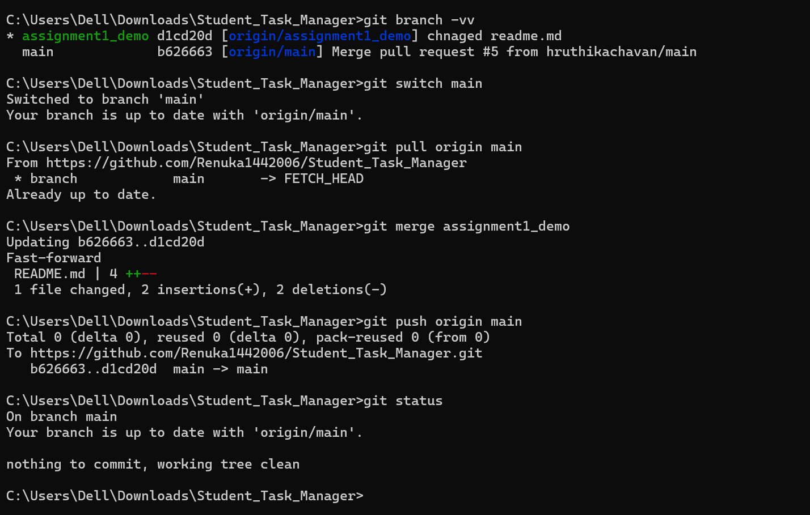
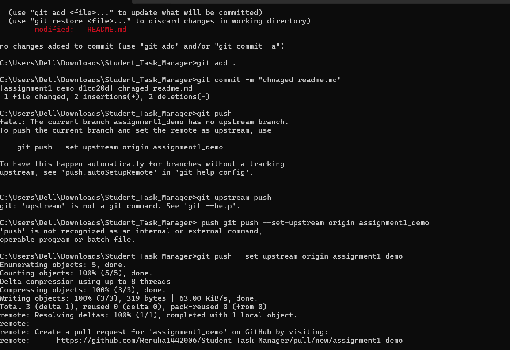
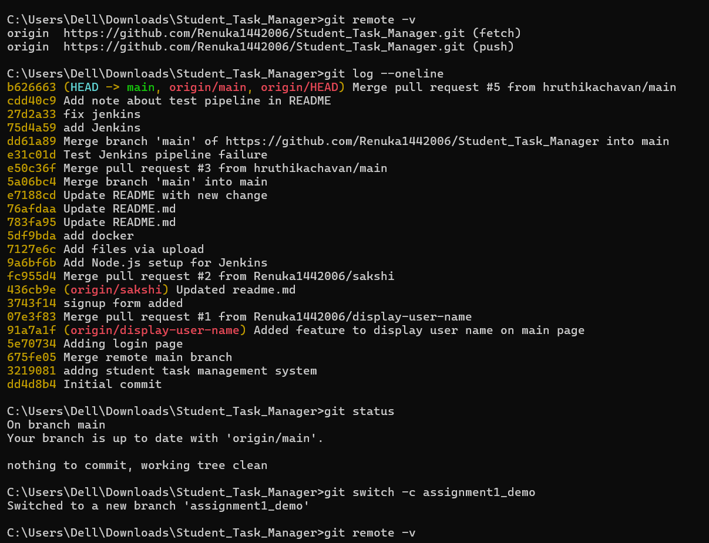

# Assignment 1: Git Basics and Version Control

## Aim
To create a GitHub repository for a sample application and demonstrate basic Git operations, including cloning, committing changes, creating branches, merging, pushing, and pulling.

## Application
Student Task Manager Web Application

## Software Requirements
- Git
- GitHub
- Command Prompt
- Student Task Manager Web Application repository

## Practical Demonstration

### Screenshot 1: Git Repository, Status, and Commit

---

### Screenshot 2: Branch Creation and Push

---

### Screenshot 3: Pull, Merge, and Final Verification

---

## Conclusion
The basic Git and GitHub operations were demonstrated using the Student Task Manager Web Application. The practical included repository management, committing changes, branch creation, pushing, pulling, and merging.
