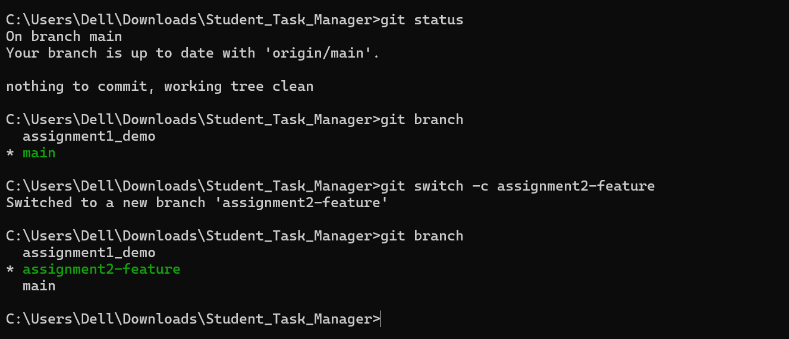
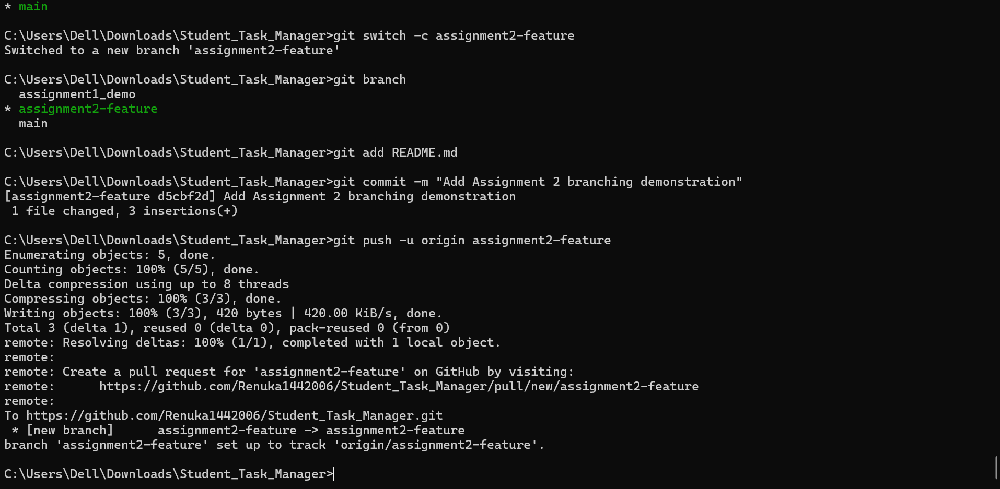
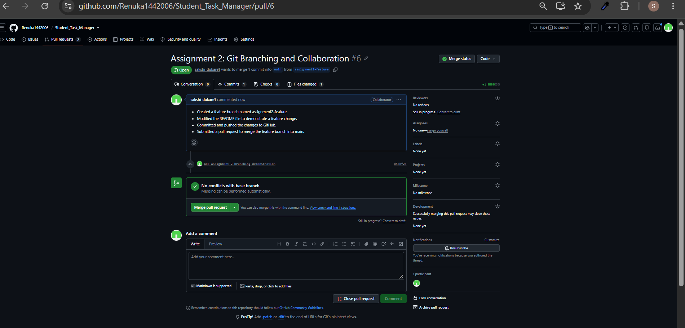
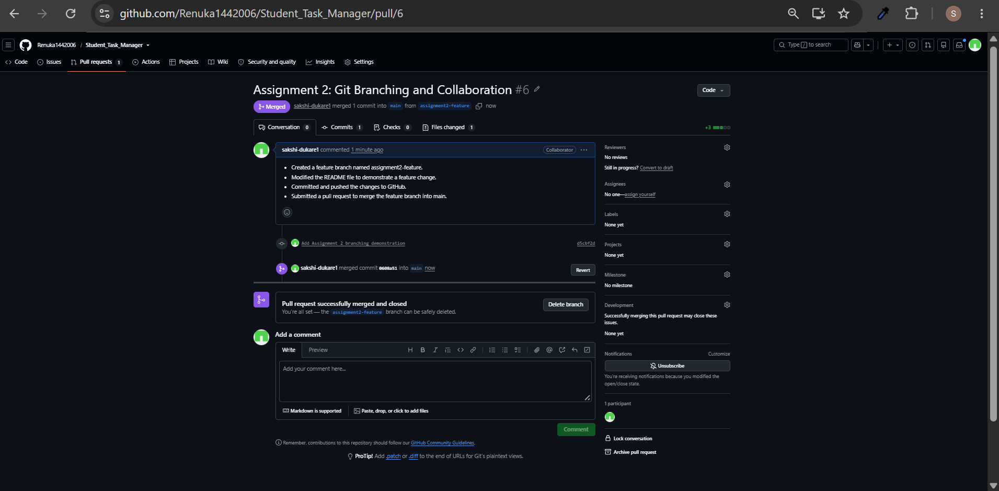

# Assignment 2: Git Branching and Collaboration

## Aim
To demonstrate collaborative development using Git branches, commits, pull requests, code review, and merging.

## Practical Demonstration

### Screenshot 1: Feature Branch Creation

---

### Screenshot 2: Commit and Push

---

### Screenshot 3: Pull Request Creation

---

### Screenshot 4: Pull Request Merge

---

## Conclusion
The Git branching and collaboration workflow was demonstrated by creating a feature branch, committing changes, pushing the branch to GitHub, creating a pull request, reviewing the changes, and merging the pull request into the main branch.