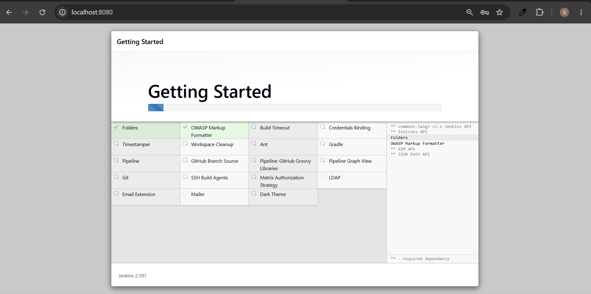
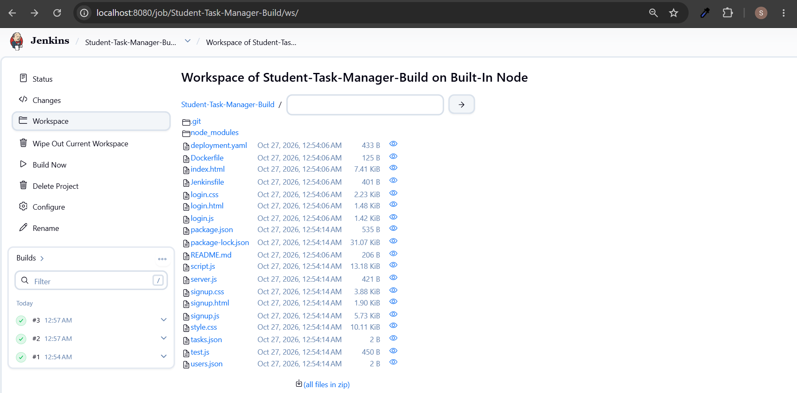

# Assignment 3: Jenkins Build

## Aim
To configure Jenkins and create a job to automatically retrieve source code from GitHub and execute a build.

## Tools and Technologies
- Jenkins
- Git
- GitHub
- Node.js
- npm
- Student Task Manager application

## Project Repository
GitHub Repository: https://github.com/Renuka1442006/Student_Task_Manager

## Procedure

### Step 1: Start Jenkins
Jenkins was started and accessed through the local browser at:

```text
http://localhost:8080/
```

### Step 2: Create a Jenkins Job
1. Open the Jenkins dashboard.
2. Click **New Item**.
3. Enter the job name `Student-Task-Manager-Build`.
4. Select **Freestyle project**.
5. Click **OK**.

### Step 3: Configure Source Code Management
1. Open the job configuration page.
2. Select **Git** under Source Code Management.
3. Enter the GitHub repository URL:

```text
https://github.com/Renuka1442006/Student_Task_Manager.git
```

4. Set the branch specifier to:

```text
*/main
```

### Step 4: Configure Build Commands
Under **Build Steps**, select **Execute Windows batch command** and enter:

```bat
node --version
npm --version
npm install
npm test
```

These commands check the Node.js and npm versions, install project dependencies, and execute the project's test script.

### Step 5: Save and Run the Job
1. Click **Save**.
2. Click **Build Now**.
3. Open the build number under Build History.
4. Click **Console Output** to inspect the build log.

### Step 6: Verify the Build
The initial Jenkins build successfully cloned the GitHub repository and checked out the `main` branch.

The console output showed:

```text
Finished: SUCCESS
```


### Screenshot 1: Jenkins dashboard.



---

### Screenshot 2: Build steps configuration.



---

### Screenshot 3: Console Output showing `Finished: SUCCESS`. completed build.


## Result
Jenkins was configured to connect to the Student Task Manager GitHub repository. The initial build successfully retrieved the source code and checked out the `main` branch. The console output confirmed successful completion of that build.
