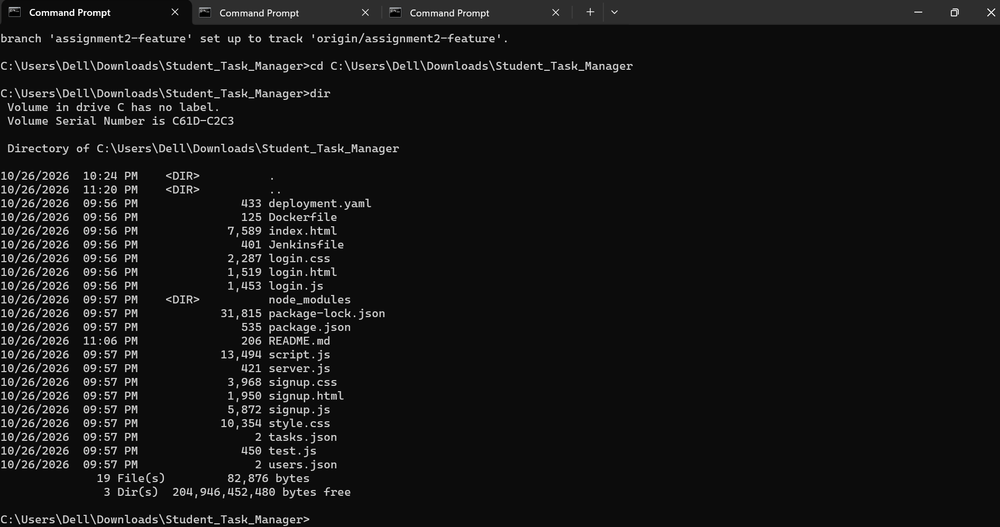
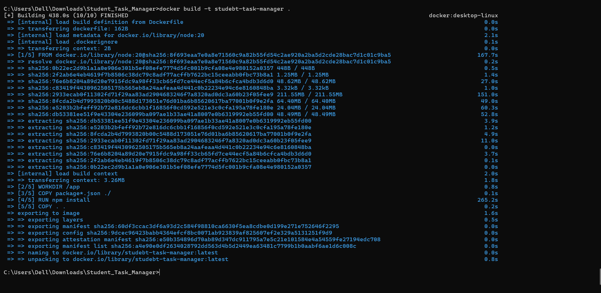
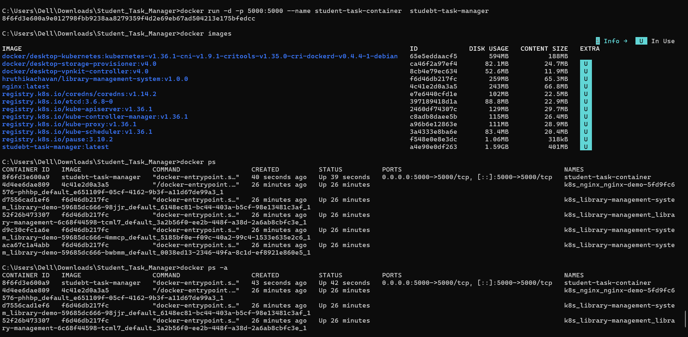
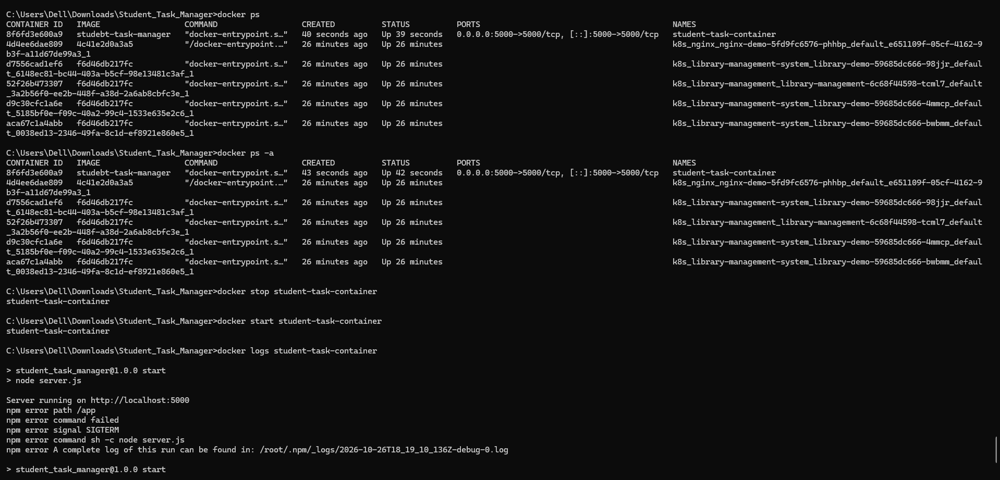
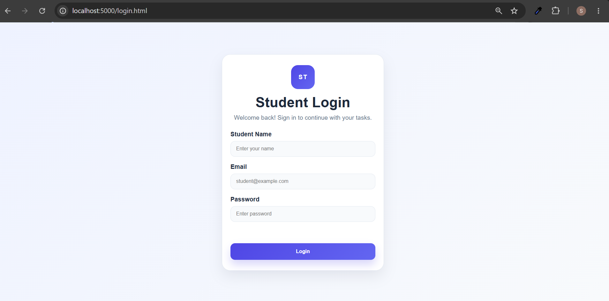

# Assignment 4: Dockerization

## Aim
To containerize the Student Task Manager web application using Docker.

## Tools and Technologies
- Docker Desktop
- Docker CLI
- Node.js
- Dockerfile
- Student Task Manager web application

## Practical Demonstration

### Screenshot 1: Project Files and Dockerfile


---

### Screenshot 2: Docker Image Build


---

### Screenshot 3: Docker Images


---

### Screenshot 4: Running Docker Container


---

### Screenshot 5: Application Running in Browser


## Commands Used

### Build the Docker image
```bash
docker build -t student-task-manager:v1 .
```

### List Docker images
```bash
docker images
```

### Run the container
```bash
docker run -d -p 5000:5000 --name student-task-container student-task-manager:v1
```

### List running containers
```bash
docker ps
```

## Conclusion
Docker was used to package the Student Task Manager application into an image and prepare it to run in a container.