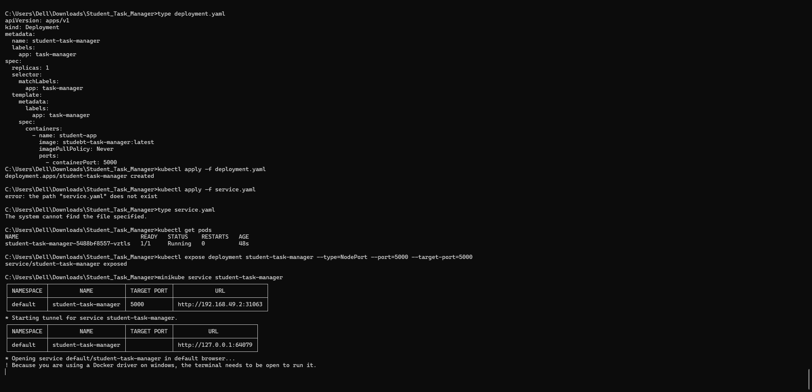
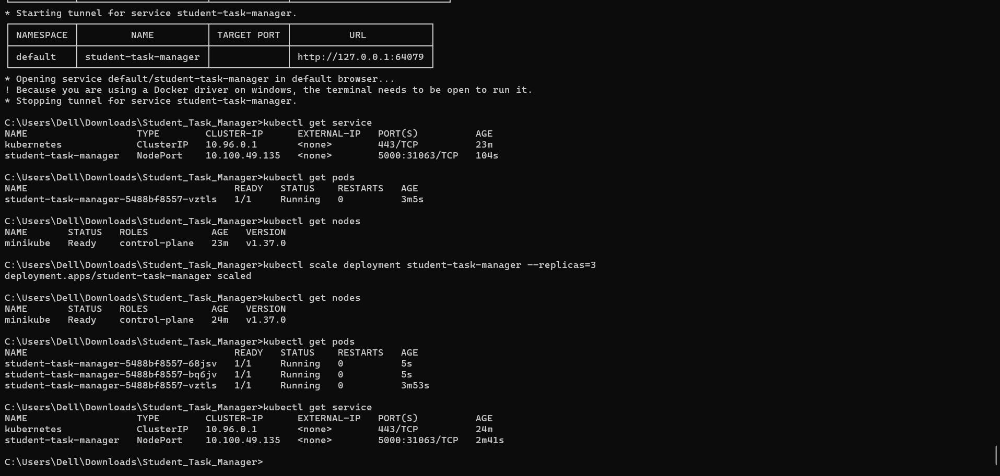
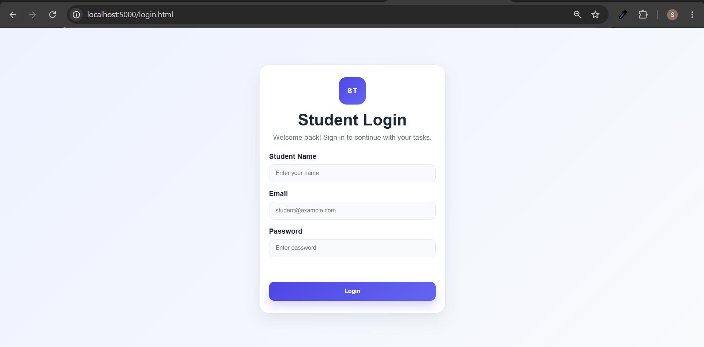

# Assignment 5: Kubernetes Deployment Using Minikube

## Aim
To deploy the Student Task Manager application on Kubernetes using Minikube and manage the application using Kubernetes commands.

## Tools and Technologies
- Docker Desktop
- Docker
- Kubernetes
- Minikube
- kubectl
- Student Task Manager application

## Prerequisites
- Docker Desktop installed and running
- Minikube installed
- kubectl installed
- Docker image of the Student Task Manager application available locally

## Procedure

### Step 1: Verify Kubernetes Tools

Check the kubectl installation:

```bash
kubectl version --client
```

Check the Minikube version:

```bash
minikube version
```

### Step 2: Start Minikube

Start the Kubernetes cluster using Docker as the driver:

```bash
minikube start --driver=docker
```

Verify that the Kubernetes node is ready:

```bash
kubectl get nodes
```

### Step 3: Load the Docker Image into Minikube

Load the existing Student Task Manager image into Minikube:

```bash
minikube image load studebt-task-manager:latest
```

Verify that the image is available:

```bash
minikube image ls
```

### Step 4: Configure the Deployment

Create a `deployment.yaml` file with the following configuration:

```yaml
apiVersion: apps/v1
kind: Deployment
metadata:
  name: student-task-manager
  labels:
    app: task-manager
spec:
  replicas: 1
  selector:
    matchLabels:
      app: task-manager
  template:
    metadata:
      labels:
        app: task-manager
    spec:
      containers:
        - name: student-app
          image: studebt-task-manager:latest
          imagePullPolicy: Never
          ports:
            - containerPort: 5000
```

**Note:** The Docker image name `studebt-task-manager:latest` is the name used for this practical.

### Step 5: Deploy the Application

Apply the deployment configuration:

```bash
kubectl apply -f deployment.yaml
```

Check the Pods:

```bash
kubectl get pods
```

Check the Deployment:

```bash
kubectl get deployment
```

### Step 6: Create a Kubernetes Service

Expose the Deployment using a NodePort Service:

```bash
kubectl expose deployment student-task-manager --type=NodePort --port=5000 --target-port=5000
```

Verify the Service:

```bash
kubectl get service
```

### Step 7: Access the Application

Run the following command to open the application:

```bash
minikube service student-task-manager
```

The Service forwards requests to the application running inside the Kubernetes Pod.

### Step 8: Scale the Deployment

Scale the application to three replicas:

```bash
kubectl scale deployment student-task-manager --replicas=3
```

Verify the Pods:

```bash
kubectl get pods
```

Verify the Deployment:

```bash
kubectl get deployment
```

Once all Pods are ready, the Deployment should show three available replicas.

## Screenshots


 ### Screenshot 1: Minikube cluster started and node status, Docker image loaded into 
Minikube.


---

### Screenshot 2: Kubernetes Deployment created,Pods running successfully,Pods running successfully.


---

### Screenshot 3:Deployment scaled to three replicas.


---

### Screenshot 4: Application opened using Minikube Service.


---


## Result

The Student Task Manager application was successfully deployed on Kubernetes using Minikube. A NodePort Service was created to access the application, and the Deployment was scaled to three replicas.
