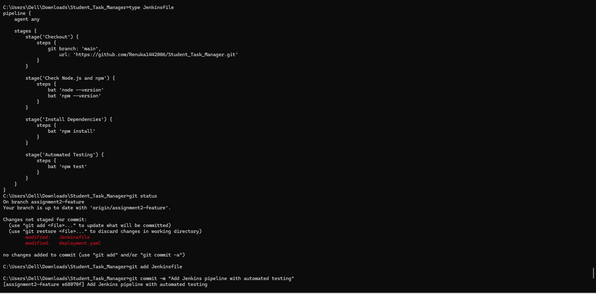
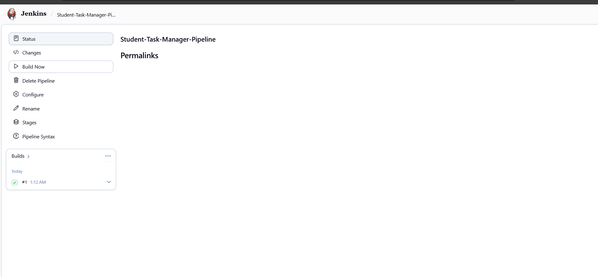
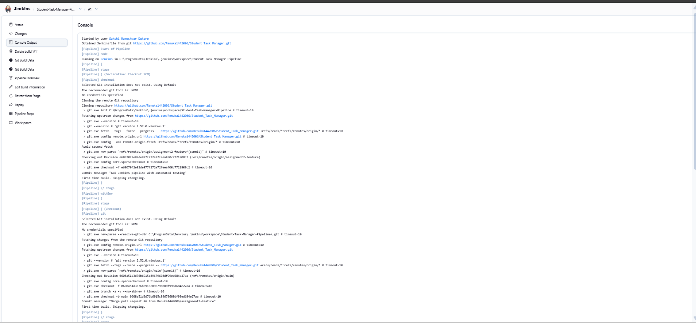

# Assignment 6: Jenkins Pipeline with Automated Testing

## Aim
To create a Jenkins Pipeline that automates source code checkout, dependency installation, and testing of the Student Task Manager application.

## Tools and Technologies
- Jenkins
- Git
- GitHub
- Node.js
- npm
- Student Task Manager application

## Project Repository
GitHub Repository: https://github.com/Renuka1442006/Student_Task_Manager

## Procedure

### Step 1: Create a Jenkinsfile
A file named `Jenkinsfile` was created in the Student Task Manager project directory to define the pipeline stages.

### Step 2: Configure Pipeline Stages
The pipeline contains the following stages:

1. **Checkout:** Retrieves the project source code from GitHub.
2. **Check Node.js and npm:** Checks the installed Node.js and npm versions.
3. **Install Dependencies:** Installs the project dependencies using `npm install`.
4. **Automated Testing:** Runs the project tests using `npm test`.

### Step 3: Jenkinsfile Configuration

The pipeline script is:

```groovy
pipeline {
    agent any

    stages {
        stage('Checkout') {
            steps {
                git branch: 'main',
                    url: 'https://github.com/Renuka1442006/Student_Task_Manager.git'
            }
        }

        stage('Check Node.js and npm') {
            steps {
                bat 'node --version'
                bat 'npm --version'
            }
        }

        stage('Install Dependencies') {
            steps {
                bat 'npm install'
            }
        }

        stage('Automated Testing') {
            steps {
                bat 'npm test'
            }
        }
    }
}
```

**Note:** The Jenkins job is configured to use the `assignment2-feature` branch, where the `Jenkinsfile` was committed. The pipeline's Checkout stage currently specifies `main`; if you want all stages to use the same branch, update the Checkout stage to `assignment2-feature` before running the pipeline.

### Step 4: Push the Jenkinsfile to GitHub
The `Jenkinsfile` was committed and pushed to the `assignment2-feature` branch.

Commands used:

```bash
git add Jenkinsfile
git commit -m "Add Jenkins pipeline with automated testing"
git push origin assignment2-feature
```

### Step 5: Create a Jenkins Pipeline Job
1. Open Jenkins at `http://localhost:8080/`.
2. Click **New Item**.
3. Enter the job name `Student-Task-Manager-Pipeline`.
4. Select **Pipeline** and click **OK**.
5. Under the Pipeline section, select **Pipeline script from SCM**.
6. Select **Git** as the SCM.
7. Enter the repository URL:

   `https://github.com/Renuka1442006/Student_Task_Manager.git`

8. Set the branch specifier to `*/assignment2-feature`.
9. Set the Script Path to `Jenkinsfile`.
10. Click **Save**.

### Step 6: Run the Pipeline
1. Open the `Student-Task-Manager-Pipeline` job.
2. Click **Build Now**.
3. Open the latest build under Build History.
4. Click **Console Output** to view the execution logs.

### Step 7: Verify the Results
Check the console output for each pipeline stage:
- Checkout
- Check Node.js and npm
- Install Dependencies
- Automated Testing

A successful pipeline should finish with:

```text
Finished: SUCCESS
```

If the pipeline fails, inspect the Console Output to identify and resolve the error.

## Screenshots


### Screenshot 1: Jenkins Pipeline job configuration.


---

### Screenshot 2: Pipeline Build History.



---

### Screenshot 3: Console Output showing the final build result.



## Result
A Jenkins Pipeline was configured for the Student Task Manager application to automate source code checkout, dependency installation, and automated testing. The final build status should be verified from the Jenkins Console Output.