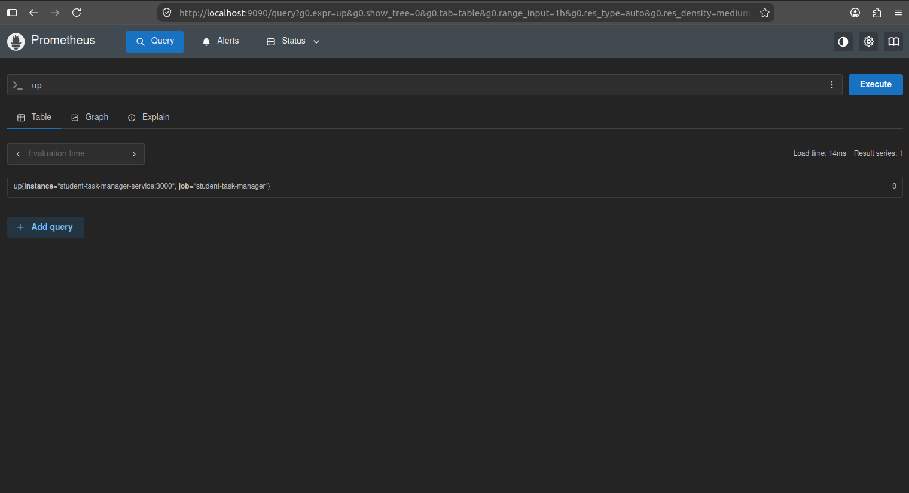
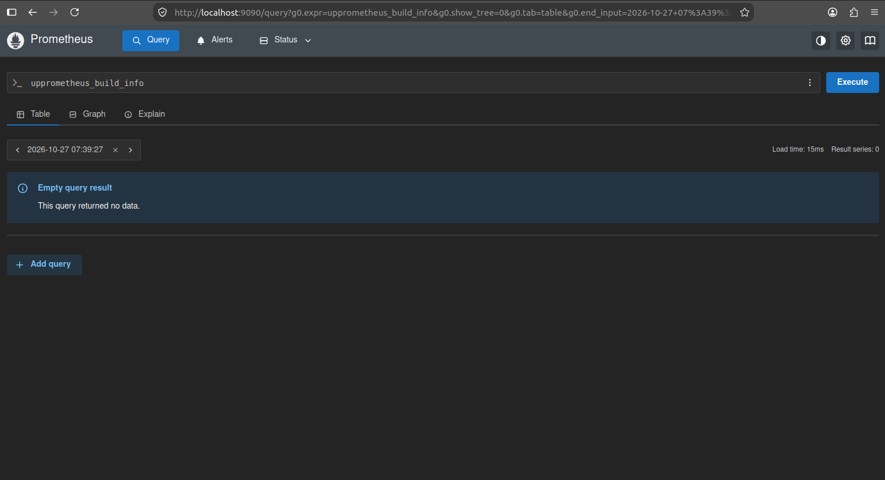
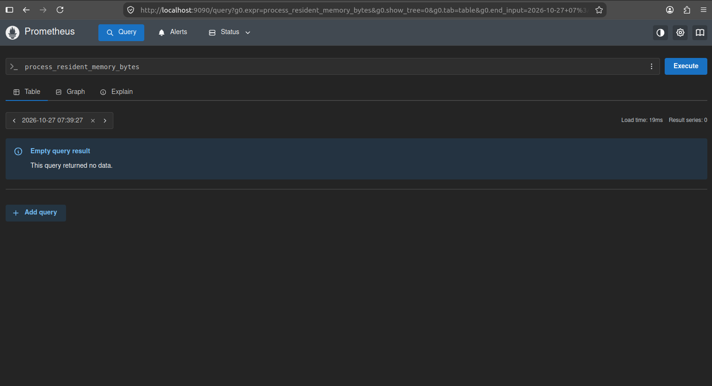

# Assignment 7: Monitoring with Prometheus

## Aim
To set up Prometheus for monitoring and collecting metrics from a system or application and to observe the collected metrics through the Prometheus web interface.

## Tools and Technologies
- Prometheus
- Docker
- Student Task Manager application
- Prometheus Web UI

## Introduction
Prometheus is an open-source monitoring and alerting toolkit. It collects metrics from configured targets at regular intervals and stores the collected data as time-series data. The Prometheus web interface allows users to query and inspect metrics.

## Procedure

### Step 1: Verify Docker
Ensure Docker Desktop is installed and running.

Check the Docker version:

```bash
docker --version
```

### Step 2: Create a Prometheus Configuration File
Create a file named `prometheus.yml` with the following configuration:

```yaml
global:
  scrape_interval: 15s

scrape_configs:
  - job_name: "prometheus"
    static_configs:
      - targets: ["localhost:9090"]
```

This configuration tells Prometheus to collect its own metrics every 15 seconds.

### Step 3: Run Prometheus Using Docker
Run the following command from the directory containing `prometheus.yml`:

```bash
docker run -d --name prometheus -p 9090:9090 -v "${PWD}/prometheus.yml:/etc/prometheus/prometheus.yml" prom/prometheus
```

**Note:** The command above uses shell syntax commonly supported in Linux shells. On Windows Command Prompt, use an absolute path to the configuration file instead, for example:

```cmd
docker run -d --name prometheus -p 9090:9090 -v "C:\path\to\prometheus.yml:/etc/prometheus/prometheus.yml" prom/prometheus
```

Replace `C:\path\to\prometheus.yml` with the actual path to your file.

### Step 4: Verify the Prometheus Container
Check whether the Prometheus container is running:

```bash
docker ps
```

### Step 5: Open the Prometheus Web Interface
Open the following address in your browser:

```text
http://localhost:9090
```

The Prometheus web interface should appear if the container started successfully.

### Step 6: Query Metrics
1. Open the Prometheus web interface.
2. Enter the following metric in the query field:

```promql
up
```

3. Click **Execute**.
4. Review the results to see whether the configured monitoring target is available.

A value of `1` indicates that a target is reachable; `0` indicates that Prometheus cannot scrape that target successfully.

### Screenshot 1: up



---

### Screenshot 2:prometheus_build_info



---

### Screenshot 3:process_resident_memory_bytes




### Screenshot 4: scrape_duration_seconds


## Result
Prometheus was configured and run using Docker. The Prometheus web interface was used to query the `up` metric and inspect the status of the configured monitoring target.
