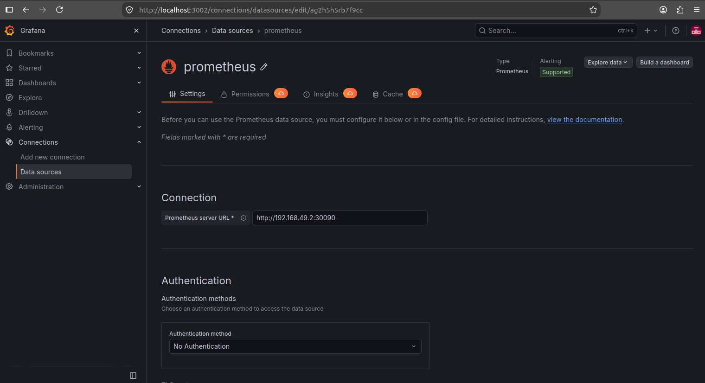
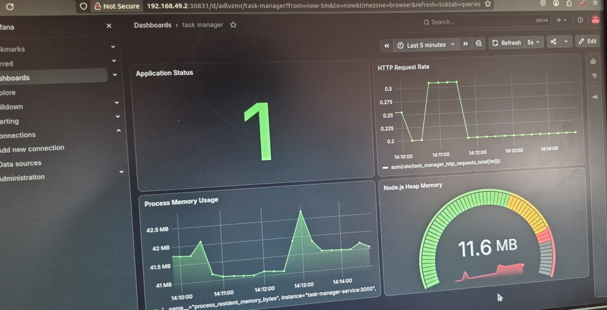

# Assignment 8: Visualization with Grafana

## Aim
To configure Grafana for visualizing monitoring metrics and creating dashboards using data collected by Prometheus.

## Tools and Technologies
- Grafana
- Prometheus
- Docker
- Web Browser

## Introduction
Grafana is an open-source monitoring and visualization platform used to display metrics through dashboards, graphs, and charts. It can connect to Prometheus as a data source to visualize system and application metrics.

## Procedure

### Step 1: Start Grafana Using Docker
Run the following command in Command Prompt or a terminal:

```bash
docker run -d --name grafana -p 3000:3000 grafana/grafana
```

This downloads the Grafana image if needed and starts a Grafana container.

### Step 2: Verify the Grafana Container
Check whether Grafana is running:

```bash
docker ps
```

Confirm that the Grafana container is listed and port `3000` is published.

### Step 3: Open Grafana
Open the following address in your browser:

```text
http://localhost:3000
```

Log in with the default credentials if you have not changed them:

- **Username:** `admin`
- **Password:** `admin`

Grafana may prompt you to change the password after the first login.

### Step 4: Add Prometheus as a Data Source
1. Open Grafana.
2. Navigate to **Connections → Data sources**.
3. Click **Add data source**.
4. Select **Prometheus**.
5. Enter the Prometheus server URL.

If Prometheus is running in a separate Docker container on the same Docker network, use its reachable container or service address, for example:

```text
http://prometheus:9090
```

If Prometheus is running directly on the host, the correct URL depends on the Docker networking configuration. `localhost` inside the Grafana container refers to Grafana itself, not the host machine.

6. Click **Save & test**.
7. Confirm that Grafana successfully connects to Prometheus.

### Step 5: Create a Dashboard
1. Open **Dashboards**.
2. Click **New → New dashboard**.
3. Select **Add visualization**.
4. Choose Prometheus as the data source.

### Step 6: Add a Metrics Query
Enter the following PromQL query:

```promql
up
```

This query displays whether Prometheus can successfully scrape each configured monitoring target.

Click **Run queries** if needed, then select a visualization such as **Time series** or **Stat**.

### Step 7: Save the Dashboard
1. Click **Save dashboard**.
2. Enter a dashboard name, such as `Prometheus Monitoring Dashboard`.
3. Click **Save**.

The dashboard can now display the metrics returned by Prometheus.

## Screenshots


### Screenshot 1: Grafana Running in Docker


### Screenshot 2: Monitoring Dashboard



## Result
Grafana was configured for metrics visualization using Prometheus as a data source. A dashboard was created to display the `up` metric and visualize the status of configured monitoring targets.
